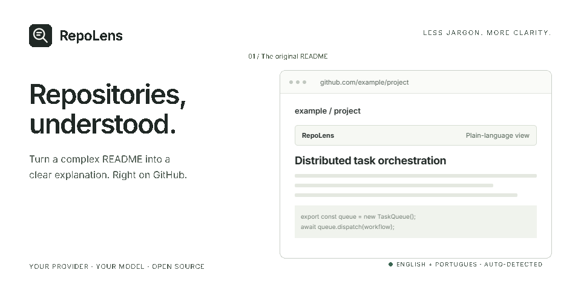

<p align="center"></p>

# RepoLens

**Repositories, understood.** A lightweight Chrome extension that explains GitHub READMEs in plain language, right where you read them.

[Português brasileiro](README.pt-BR.md) · [MIT license](LICENSE) · [Animation source](docs/demo)

RepoLens replaces the README view with a short explanation of what a project does, who it helps, and what to check before trying it. Switch back to the original at any time. Repository files stay intact.

- **English and Brazilian Portuguese, automatically.** Uses Chrome's interface language for the settings, controls, errors and AI instructions. Portuguese uses pt-BR; other languages fall back to English. Restart Chrome and reload repository tabs after changing its interface language.
- **Bring your own model.** Connect a provider that implements the Chat Completions API, including a local server.
- **Keep context.** Regenerate the explanation or return to the original README with a click.
- **Small by design.** No runtime packages, tracking services, remote fonts or animated extension icons.

The header is an illustrative animation made with [Hyperframes](https://github.com/heygen-com/hyperframes), using a fictional repository and sample explanation.

## Install

1. Download this repository with **Code → Download ZIP** and extract it to a permanent folder, or clone it.
2. Open `chrome://extensions` and enable **Developer mode**.
3. Choose **Load unpacked** and select the folder containing `manifest.json`.
4. Click the RepoLens toolbar icon to configure your provider.

No build or Node.js installation is needed to use the extension. It is currently distributed as an unpacked extension, without automatic updates.

## Connect your AI provider

Enter the full Chat Completions endpoint, the provider's exact model ID, and an API key if required. Save and approve Chrome access to that provider's domain. Open or refresh a GitHub repository page.

| Provider | Endpoint |
| --- | --- |
| OpenRouter | `https://openrouter.ai/api/v1/chat/completions` |
| Groq | `https://api.groq.com/openai/v1/chat/completions` |
| Cerebras | `https://api.cerebras.ai/v1/chat/completions` |
| Local server | `http://localhost:PORT/v1/chat/completions` |

Choose a model available from your provider. A ChatGPT subscription does not supply an API key. Provider charges and rate limits may apply.

## Data and limitations

RepoLens sends the visible README text, capped at 50,000 characters, and the repository URL to the provider you configure. It stores your endpoint, model, API key and enabled preference in `chrome.storage.local`. The key is not encrypted by this extension. Chrome requests access to the configured provider domain when you save settings. There is no RepoLens backend or telemetry.

The content script runs on GitHub repository root pages. It does not verify repository visibility: **a private README visible to your account can also be sent to your provider**. Disable automatic replacement before visiting private repositories if you do not want that content sent. It does not inspect source files or verify authors' claims. AI explanations can be incomplete or inaccurate; check the original documentation. GitHub layout changes may require selector updates. Truncated input may omit relevant facts.

## Development

Use Node.js 22+ to run the built-in regression tests:

```sh
npm test
```

The extension has no build step. Reload it at `chrome://extensions` and refresh GitHub tabs after editing runtime files. Translation catalogs live in `_locales/en` and `_locales/pt_BR`.

See [docs/demo](docs/demo) for the separate Hyperframes project, render requirements and GIF regeneration. Documentation dependencies are not loaded by the extension.

## License

[MIT](LICENSE) © 2026 Jean Lorencini. Independent project; not affiliated with GitHub.
