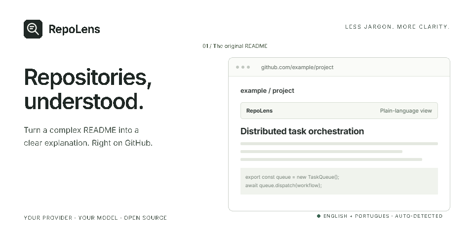

# RepoLens

**Entenda os projetos do GitHub.** Extensão leve para Chrome que explica READMEs em linguagem simples, na própria página.

[English](README.md) · [Licença MIT](LICENSE) · [Fonte da animação](docs/demo) · [Referências visuais](docs/design.md)

Descubra o que um projeto faz, para quem ele serve e o que conferir antes de experimentar. Volte ao README original quando quiser. A extensão altera a visualização na aba; os arquivos do repositório ficam intactos.

- Português brasileiro e inglês automáticos, seguindo o idioma da interface do Chrome. Isso inclui configurações, controles, erros e instruções para a IA.
- Use seu próprio provedor e modelo compatível com Chat Completions.
- Gere novamente ou recupere o original com um clique.
- Sem dependências de execução, telemetria, fontes externas ou ícones animados.

Idiomas portugueses usam pt-BR; os demais usam inglês. Após mudar o idioma da interface do Chrome, reinicie o navegador e atualize as abas. O GIF do cabeçalho foi gerado com [Hyperframes](https://github.com/heygen-com/hyperframes) e ilustra um repositório fictício.

## Instalar

1. Baixe em **Code → Download ZIP** e extraia para uma pasta fixa, ou clone o repositório.
2. Abra `chrome://extensions` e ative **Modo do desenvolvedor**.
3. Clique em **Carregar sem compactação** e escolha a pasta que contém `manifest.json`.
4. Clique no ícone do RepoLens para configurar o provedor.

Não precisa instalar Node.js nem compilar. A instalação local não tem atualização automática.

## Configurar

Informe o endereço completo de Chat Completions, o nome exato do modelo e a chave da API, quando exigida. Salve, autorize o domínio do provedor e atualize a página de um repositório.

Exemplos de endereços:

- OpenRouter: `https://openrouter.ai/api/v1/chat/completions`
- Groq: `https://api.groq.com/openai/v1/chat/completions`
- Cerebras: `https://api.cerebras.ai/v1/chat/completions`
- Servidor local: `http://localhost:PORT/v1/chat/completions`

Escolha um modelo disponível no seu provedor. A assinatura do ChatGPT não fornece uma chave de API. O provedor pode cobrar pelo uso e impor limites.

## Privacidade e limites

O texto visível do README, limitado a 50 mil caracteres, e a URL do repositório são enviados ao provedor escolhido. Endereço, modelo, chave e preferência de ativação ficam no armazenamento local da extensão. A extensão não criptografa a chave. Não existe servidor próprio do RepoLens nem telemetria.

O script atua na página principal dos repositórios. Ele não verifica a visibilidade: **READMEs privados acessíveis à sua conta também podem ser enviados ao provedor**. Desative a substituição automática antes de visitar esses repositórios se não quiser enviar esse conteúdo. A extensão não analisa os arquivos de código nem comprova afirmações dos autores. Confira a documentação original; a IA pode errar e textos cortados podem perder ressalvas. Mudanças no GitHub podem exigir ajustes na extensão.

## Desenvolvimento

Com Node.js 22+, rode `npm test`. Não há etapa de compilação. Após alterar o código, recarregue a extensão e atualize as abas do GitHub. As traduções ficam em `_locales/en` e `_locales/pt_BR`.

O projeto de animação fica em [docs/demo](docs/demo), separado da execução da extensão.

[MIT](LICENSE) © 2026 Jean Lorencini. Projeto independente, sem vínculo com o GitHub.
